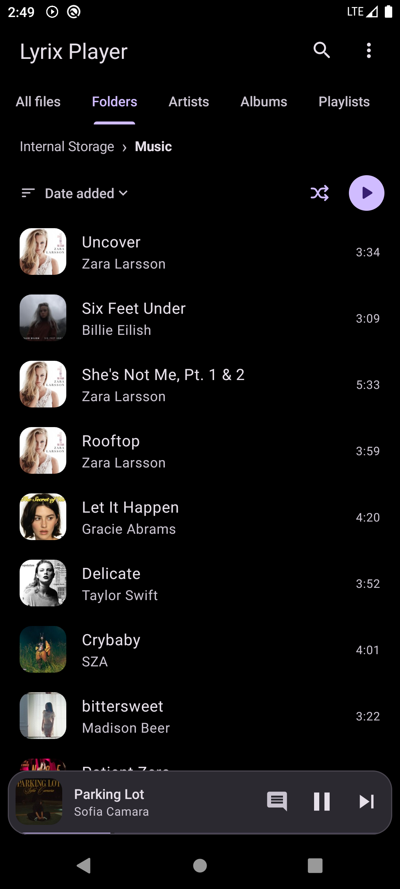
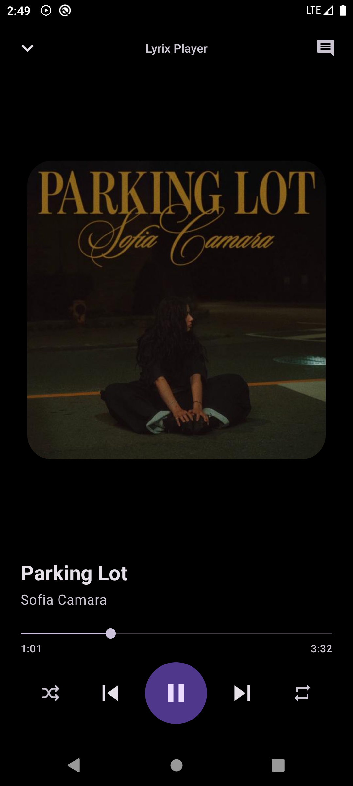
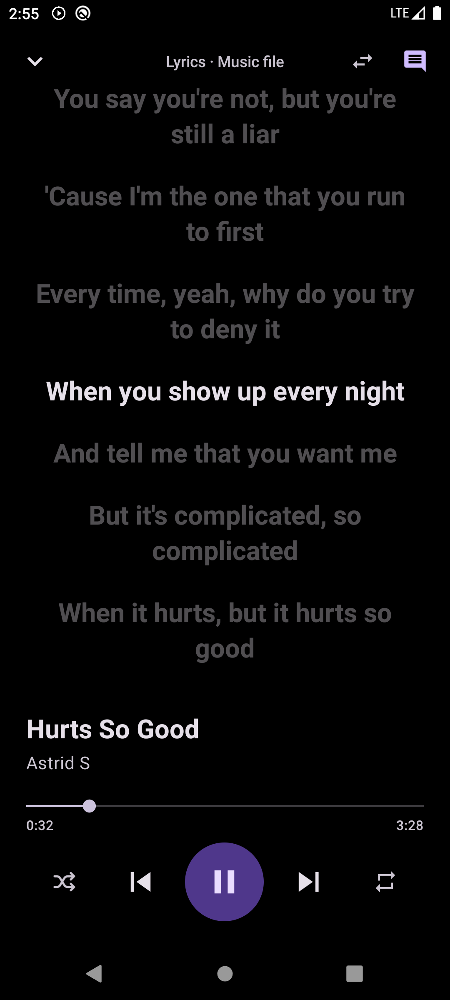
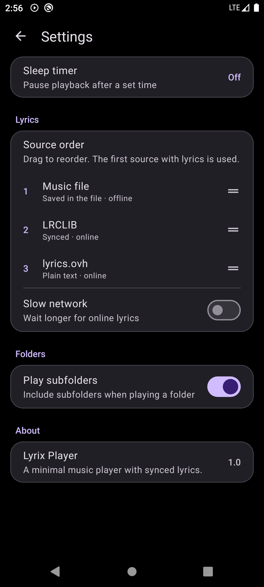

# Lyrix Player

**A clean, lightweight Android music player with synchronized lyrics.**

-brightgreen)

*Your music. Your lyrics. One simple player.*

---

> **Development Notice**  
> Lyrix Player is currently under development and will be released soon.

## About

Lyrix Player is an Android music player focused on your local music library and a simple listening experience. Browse your music, play tracks in the background, and follow synchronized lyrics while listening.

## Screenshots

  <table>
    <tr>
      <td align="center">
        
         
        <b>Music Library</b>
      </td>
      <td align="center">
        
         
        <b>Player</b>
      </td>
      <td align="center">
        
         
        <b>Lyrics</b>
      </td>
      <td align="center">
        
         
        <b>Settings</b>
      </td>
    </tr>
  </table>

## Features

- **Local music playback** — play audio files stored on your device.
- **Music library** — browse all available tracks or explore your music by folders.
- **Search** — find tracks by title, artist, album, album artist, composer, genre, year, file name, or folder.
- **Sorting** — organize tracks and folders by name, artist, album, duration, or date added, in ascending or descending order.
- **Lyrics support** — load lyrics embedded in audio files, retrieve lyrics online, or import `.lrc` files.
- **Synchronized lyrics** — automatically follow the current line during playback when timed lyrics are available.
- **Multiple lyrics sources** — use embedded lyrics, [LRCLIB](https://lrclib.net/), and [Lyrics.ovh](https://lyrics.ovh/), with a customizable source priority.
- **Background playback** — keep music playing while using other apps, with playback controls in the notification.
- **Playback controls** — play, pause, skip, shuffle, and repeat tracks or the full queue.
- **Sleep timer** — stop playback after a selected number of minutes or when the current song ends.
- **Home screen widget** — control playback and access the currently playing track from your home screen.
- **Playback restoration** — restore the saved playback state when you return to the app.
- **Folder options** — choose whether playback and shuffle include music in subfolders.

## Lyrics

Lyrix Player checks lyrics sources according to the order configured in Settings. It supports:

| Source | Lyrics type | Internet required |
| --- | --- | --- |
| Embedded lyrics | Plain or time-synced, depending on the audio file | No |
| LRCLIB | Time-synced or plain | Yes |
| Lyrics.ovh | Plain text | Yes |
| Imported `.lrc` file | Time-synced when timestamps are included | No |

Lyrics lookup is optional. Local music playback and lyrics stored in your music files are available without an internet connection.

## Built With

- **Java** — Android application development
- **XML** — layouts and interface resources
- **AndroidX Media3 / ExoPlayer** — audio playback and media sessions
- **Material Components** — user interface components
- **Glide** — album artwork loading

## Requirements

- Android 7.0 (API 24) or later
- Audio files stored on your device
- Internet connection only for online lyrics lookup

---

**Lyrix Player**  
*Listen. Follow. Feel the music.*

